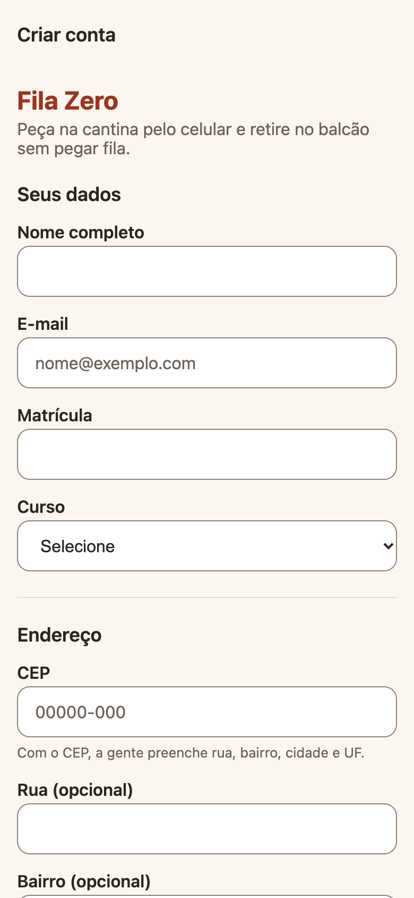
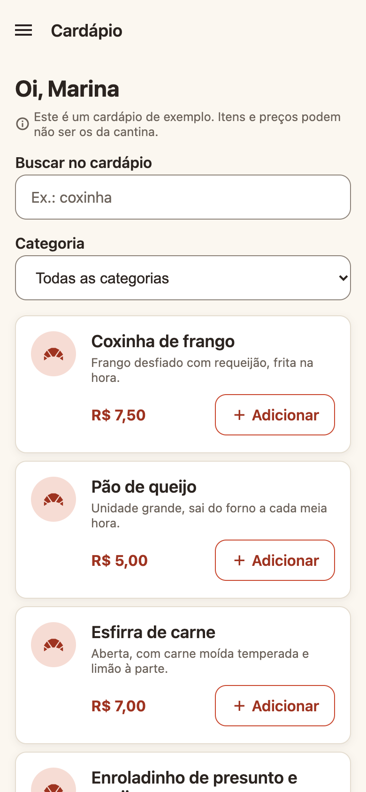
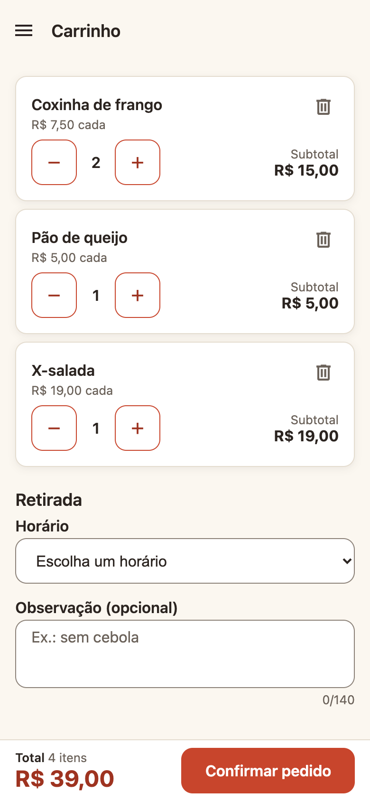
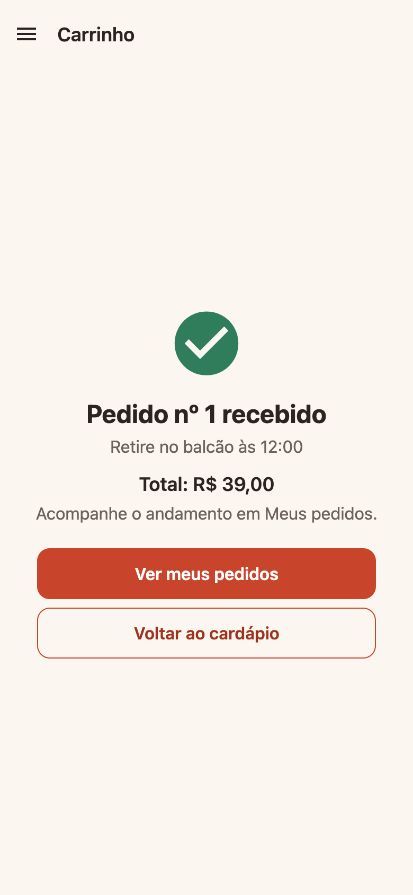
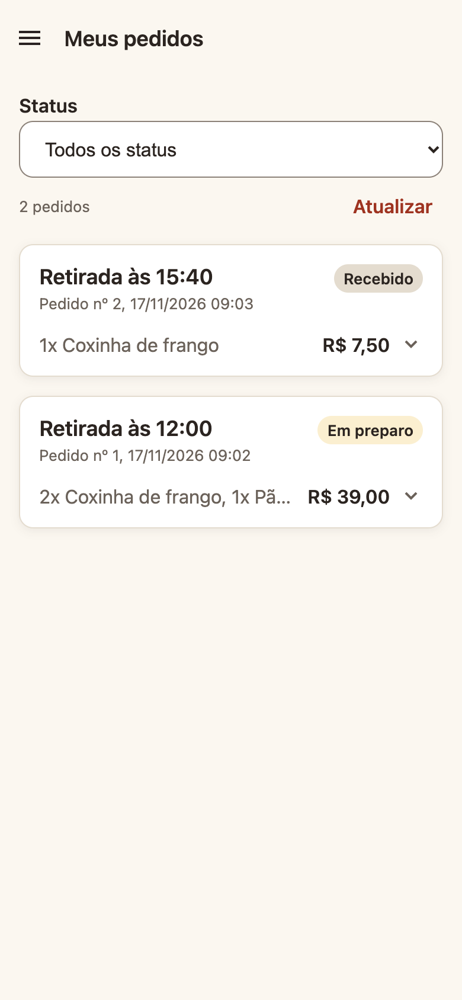
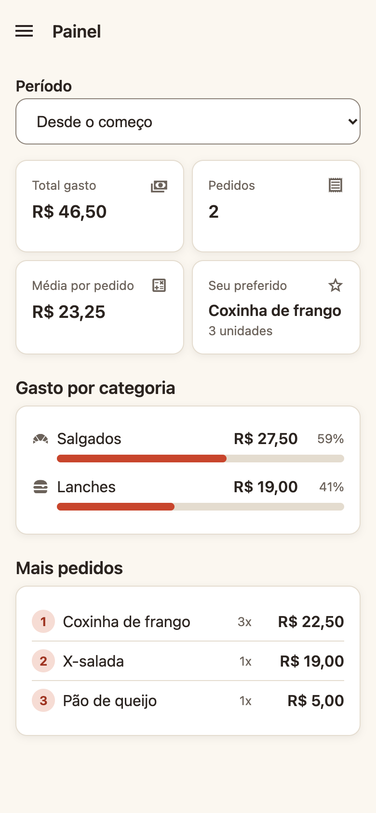
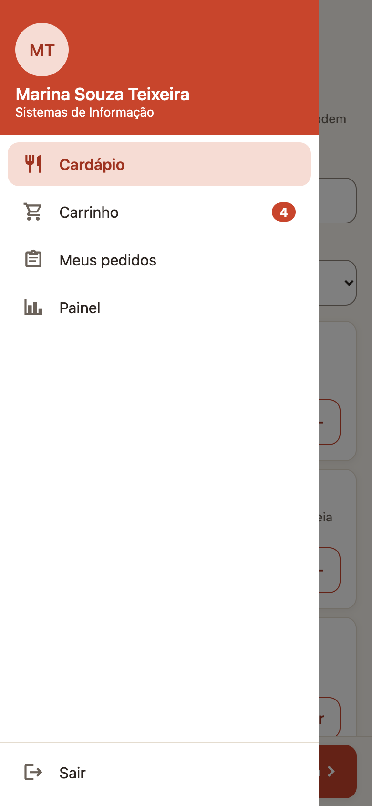

# Fila Zero

O Fila Zero é um app para pedir lanche na cantina da faculdade pelo celular. A pessoa escolhe os itens, marca em qual intervalo vai retirar e passa no balcão para pegar o pedido, em vez de esperar na fila para pedir. O pagamento não está no app.

É o trabalho final da disciplina de desenvolvimento mobile. Fizemos com React Native e Expo SDK 54, em JavaScript, com componentes de função, `useState`, `useEffect`, `useContext`, Drawer Navigator, formik, Picker, FlatList e axios. A única classe é o `LimiteDeErro`, porque o React só captura erro de renderização em componente de classe.

O app funciona sem nenhuma configuração. Enquanto não houver uma API apontada, ele usa um cardápio de exemplo que vem junto com o código.

## Telas

São cinco telas e um menu lateral. Antes do cadastro só existe a tela Criar conta. Depois dele o menu libera as outras quatro.

### Criar conta

Formulário dividido em três partes: dados pessoais (nome completo, e-mail, matrícula e curso), endereço e senha. Quando a pessoa termina de digitar o CEP, o app consulta o ViaCEP e preenche rua, bairro, cidade e UF. Cada campo mostra o próprio erro logo abaixo, e o botão Criar conta só segue quando tudo está válido. A senha é usada apenas na validação: ela não é guardada nem enviada.



### Cardápio

Lista os produtos (24 no cardápio de exemplo) com nome, descrição e preço. Dá para buscar pelo nome (a busca ignora acento) e filtrar por categoria. O botão Adicionar coloca o item no carrinho e vira um controle de quantidade. Produto esgotado vai para o fim da lista e não pode ser adicionado. Com itens no carrinho, uma barra no rodapé mostra a quantidade e o total e leva para a tela do carrinho.



### Carrinho

Mostra os itens escolhidos, com ajuste de quantidade e remoção. A pessoa escolhe o horário de retirada entre os intervalos de aula (09:50, 12:00, 15:40, 18:30 ou 20:40) e pode escrever uma observação de até 140 caracteres, como "sem cebola". Sem horário escolhido o pedido não é enviado.



Depois de confirmar, a tela mostra o número do pedido, o horário de retirada e o total, com atalhos para Meus pedidos e para o cardápio.



### Meus pedidos

Lista os pedidos da pessoa, do mais novo para o mais antigo, cada um com o horário de retirada e uma etiqueta de status. Tocar em um pedido abre os itens e a observação. O filtro mostra só os pedidos de um status (Recebido, Em preparo, Pronto para retirar ou Retirado). Dá para atualizar a lista pelo botão ou puxando para baixo.



### Painel

Resume os gastos da pessoa na cantina: total gasto, número de pedidos, média por pedido e o item que ela mais pede. Abaixo vêm o gasto por categoria, em barras com o percentual de cada uma, e os cinco itens mais pedidos. Um seletor troca o período entre hoje, últimos 7 dias, últimos 30 dias e desde o começo.



### Menu lateral

Desenhamos o nosso próprio menu no lugar do padrão do Drawer. No topo ficam as iniciais, o nome e o curso de quem está usando. Cada tela tem um ícone, a tela atual fica marcada e o item Carrinho mostra quantas unidades há nele. No rodapé fica o Sair, que esvazia o carrinho e volta para o cadastro.



## Onde está cada requisito do trabalho

| Requisito | Onde está no código |
| --- | --- |
| Mínimo de 4 telas | São cinco, uma pasta para cada em `src/screens/`: `Cadastro`, `Cardapio`, `Carrinho`, `Pedidos` e `Painel` |
| Cadastro de usuário com campos obrigatórios e validação (formik + TextInput) | `src/screens/Cadastro/index.js` usa `useFormik`. As regras de cada campo estão em `src/utils/validacoes.js`. Os `TextInput` ficam em `src/components/CampoTexto/index.js` e `src/components/CampoSenha/index.js` |
| Drawer Navigator com menu customizado | `src/navigation/index.js` cria o Drawer com `createDrawerNavigator` e passa o menu em `drawerContent`. O menu está em `src/navigation/MenuLateral/index.js` e os nomes das rotas em `src/navigation/rotas.js` |
| Tratamento de erros para evitar falhas | `src/components/LimiteDeErro/index.js` envolve a navegação e segura erro de renderização. Os serviços em `src/services/` usam `try/catch` e voltam para os dados locais quando a API falha. `src/services/cep.js` lança um erro com a mensagem já escrita para a tela. As telas mostram a falha com `src/components/Aviso/index.js` e um botão Tentar de novo |
| Contexto com `createContext` e `useContext` | `src/contexts/UsuarioContext.js`, `src/contexts/CarrinhoContext.js` e `src/contexts/PedidosContext.js`. Os três provedores entram em `App.js` |
| Comunicação direta entre componentes | `src/screens/Cardapio/index.js` passa `produto`, `categoria` e `quantidade` para `src/components/ItemCardapio/index.js`, que repassa `valor` para `src/components/ControleQuantidade/index.js` |
| Comunicação indireta entre componentes | O filho avisa o pai por função recebida em prop: `aoAdicionar`, `aoAumentar` e `aoDiminuir` em `src/components/ItemCardapio/index.js`, `aoMudar` em `src/components/Seletor/index.js` e `aoAlternar` em `src/components/CartaoPedido/index.js`. Também acontece pelo contexto: `src/screens/Cardapio/index.js` adiciona o item no `CarrinhoContext` e `src/navigation/MenuLateral/index.js` mostra o contador do carrinho, sem um saber do outro |
| Desestruturação de props | Todo componente desestrutura na assinatura. Por exemplo, `Seletor({ rotulo, valor, aoMudar, opcoes = [], erro, style })` em `src/components/Seletor/index.js` |
| Componentização com `index.js` e `styles.js` | Os 17 componentes de `src/components/`, as cinco telas de `src/screens/` e o `src/navigation/MenuLateral/` têm cada um a sua pasta com os dois arquivos |
| Filtro com Picker + FlatList | O `Picker` fica em `src/components/Seletor/index.js`. Em `src/screens/Cardapio/index.js` ele filtra a `FlatList` por categoria e em `src/screens/Pedidos/index.js` filtra por status |
| API REST com GET | `listarProdutos` e `listarCategorias` em `src/services/produtos.js`, `listarPedidos` em `src/services/pedidos.js` e `buscarCep` em `src/services/cep.js` |
| API REST com POST | `criarPedido` em `src/services/pedidos.js` e `cadastrarUsuario` em `src/services/usuarios.js` |
| axios | A instância com a URL base está em `src/services/api.js` |
| Dados locais quando não há API | `src/data/produtos.json` e `src/data/categorias.json`, usados pelos serviços. `src/data/cursos.json` e `src/data/horarios.json` alimentam os seletores de curso e de horário |
| Projeto no Snack da Expo | Link na seção Como rodar |

## Como rodar

Precisa do Node instalado. Usamos a versão 22.

```bash
npm install
npm run web
```

`npm run web` abre o app no navegador. Para abrir no celular, rode `npx expo start` e leia o QR code com o Expo Go.

O projeto também abre no Snack da Expo, direto no navegador:

Snack: <link a preencher>

Lá, a prévia aparece na aba Web.

## Dados e API

### Modo local

Se `URL_BASE` em `src/services/api.js` estiver vazia, o app não faz nenhuma chamada de cardápio ou de pedido. Produtos e categorias vêm dos arquivos de `src/data/`, e o cadastro e os pedidos ficam só em memória, então somem quando o app é fechado ou recarregado. Nesse modo o cardápio mostra um aviso de que os itens e os preços são de exemplo.

Os serviços de produtos, pedidos e usuários devolvem `{ dados, origem }`, com `origem` igual a `'api'` ou `'local'`. Se a API estiver configurada e a chamada falhar, eles caem para os dados locais, então a tela não quebra por falta de rede. A exceção é o `buscarCep`, que devolve o endereço e, quando o CEP não existe ou a rede falha, lança um erro com a mensagem que a tela mostra.

### Ligando ao mockapi.io

1. Crie uma conta e um projeto em [mockapi.io](https://mockapi.io).
2. Crie os quatro recursos abaixo, com estes nomes e campos. O `id` o próprio mockapi gera.
3. Copie o endereço do projeto, terminando em `/api/`, e cole em `URL_BASE` no arquivo `src/services/api.js`.

| Recurso | Campos |
| --- | --- |
| `produtos` | `nome`, `descricao`, `preco` (número, em reais), `categoria` (o `id` de uma categoria), `disponivel` (booleano) |
| `categorias` | `nome`, `icone` (nome de um ícone do MaterialCommunityIcons) |
| `pedidos` | `usuarioId`, `itens` (lista de `{ produtoId, nome, preco, quantidade, categoria }`), `total`, `retirada` (horário, como `"09:50"`), `observacao`, `status`, `criadoEm` (data ISO) |
| `usuarios` | `nome`, `email`, `matricula`, `curso`, `cep`, `logradouro`, `bairro`, `cidade`, `uf` |

As rotas que o app chama são `GET /produtos`, `GET /categorias`, `GET /pedidos?usuarioId=`, `POST /pedidos` e `POST /usuarios`. O conteúdo de `src/data/produtos.json` e `src/data/categorias.json` serve de base para preencher os dois primeiros recursos.

### ViaCEP

O cadastro consulta `https://viacep.com.br/ws/<cep>/json/` assim que o CEP chega a oito dígitos. Essa chamada não depende do mockapi e funciona também no modo local. Se o CEP não existir ou a rede falhar, a mensagem aparece embaixo do campo. Rua e bairro são opcionais porque CEP de cidade pequena vem sem esses dados.

### Andamento do pedido

O andamento do pedido é simulado. Não existe uma cozinha do outro lado mudando o status, nem no modo local nem no mockapi. O pedido é gravado como `recebido` e a tela Meus pedidos calcula o status pelo tempo que passou desde a criação:

- menos de 1 minuto: Recebido
- de 1 a 3 minutos: Em preparo
- mais de 3 minutos: Pronto para retirar
- pedido de um dia anterior: Retirado

A conta está em `statusAtual`, em `src/utils/statusPedido.js`. A tela consulta o relógio a cada 30 segundos. Se alguém editar o status de um pedido direto no mockapi, o app mostra o valor gravado e não simula mais nada para aquele pedido.

### Conta

Não existe login. O app só tem o cadastro, e quem sai da conta volta para ele. Cada cadastro cria um usuário novo, então os pedidos feitos antes de sair não aparecem no cadastro seguinte.

## Testes

Os testes usam Jest (preset `jest-expo`) e `@testing-library/react-native`, e ficam em `__tests__/`, seguindo as pastas de `src/`.

```bash
npm test
```

São mais de 450 testes, todos passando. Eles cobrem:

- os 17 componentes de `src/components/`
- as cinco telas, do jeito que a pessoa usa (preencher o cadastro e ver os erros, filtrar o cardápio e por aí vai)
- os três contextos
- a navegação: o que aparece com e sem usuário, o menu lateral e o Sair
- os serviços, com o axios simulado, incluindo a queda para os dados locais
- as funções de formatação, de validação, de resumo do painel e de status do pedido

Trabalhamos com TDD: em cada pull request, o teste de um comportamento entrou em um commit antes da implementação. Como a `main` recebe os PRs com squash, essa ordem aparece nos commits de cada PR (#12 a #20), e não no histórico da `main`. O GitHub Actions roda `npm test` em todo pull request e a cada push na `main` (`.github/workflows/testes.yml`).

## Organização das pastas

```
App.js                     provedores de contexto e as rotas
src/theme/index.js         cores, espaços, raios, fontes e sombra
src/services/              axios e acesso aos dados
src/data/                  dados locais (JSON) usados quando não há API
src/contexts/              UsuarioContext, CarrinhoContext, PedidosContext
src/utils/                 formatação, validação, resumo e status do pedido
src/components/<Nome>/     index.js + styles.js
src/navigation/            Drawer e menu lateral
src/screens/<Nome>/        index.js + styles.js
__tests__/                 testes, seguindo as pastas de src
```

O detalhe de cada módulo (formato dos dados, o que cada serviço e cada contexto devolve) está em [docs/ARQUITETURA.md](docs/ARQUITETURA.md).

## Paleta de cores

As cores ficam em `src/theme/index.js` e nenhum componente escreve cor direto no estilo. As principais:

| Token | Hex | Para que serve |
| --- | --- | --- |
| `primaria` | `#C8452C` | Botão principal, barra do carrinho, cabeçalho do menu e barras do painel |
| `primariaEscura` | `#9E3320` | Texto e ícones de ação sobre fundo claro |
| `primariaClara` | `#F6DCD4` | Fundo do item ativo no menu, do ícone dos produtos e do controle de quantidade |
| `destaque` | `#E9A820` | Borda dos avisos de atenção |
| `sucesso` | `#2F7D5B` | Confirmação do pedido e borda do pedido pronto |
| `erro` | `#B3261E` | Mensagens de erro e borda de campo inválido |
| `fundo` | `#FBF7F0` | Fundo das telas |
| `superficie` | `#FFFFFF` | Cartões e campos |
| `borda` | `#E4DCCF` | Divisores e contorno dos cartões |
| `bordaCampo` | `#8C8279` | Contorno dos campos de texto e dos seletores |
| `texto` | `#2B2420` | Texto principal |
| `textoSuave` | `#6B625A` | Legendas e textos de apoio |

A cor principal é uma terracota, que lembra comida e se destaca nos botões, por isso ela fica no que leva ao pedido. O fundo é creme e os cartões são brancos, para separar um do outro. O verde só aparece quando algo deu certo, como o pedido confirmado ou pronto para retirar.

O texto atende ao contraste AA da WCAG: o texto principal sobre o fundo dá 14,3:1, o texto suave dá 5,6:1 e o branco sobre a cor principal dá 4,8:1, todos acima do mínimo de 4,5:1.
